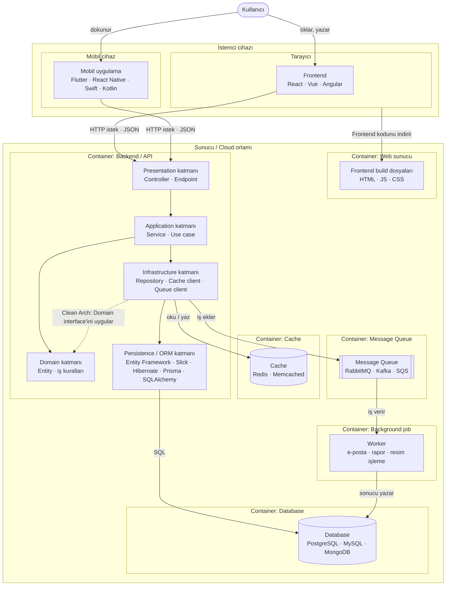
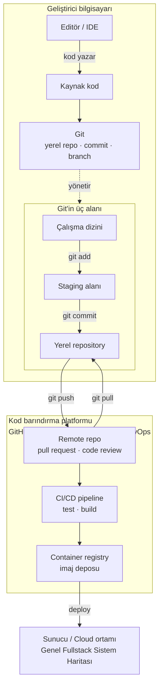

## Genel Fullstack Sistem Haritası

**Ok türleri:** Düz ok isteği veya veriyi gösterir. Ok, işi başlatan kutudan çıkar. Kesikli ok kod bağımlılığını gösterir.

## Development Süreci

**Ok türleri:** Düz ok kodun veya komutun yönünü gösterir. Kesikli ok "yönetir" ilişkisini gösterir.

**İki harita nerede birleşir:** `deploy` oku bu diyagramdan çıkar. Ok, Genel Fullstack Sistem Haritası'ndaki Sunucu / Cloud ortamına gider. Yeni container'lar orada çalışmaya başlar.

## Sık Kullanılan Tool'lar

| Tool ismi | İşlevi | Full stack haritasında nereye oturuyor |
|---|---|---|
| SSMS | SQL Server veritabanını yönetir. Sorgu çalıştırır, tablo ve index oluşturur. Yalnızca SQL Server ile çalışır. | Geliştirici bilgisayarında çalışır. Database kutusuna bağlanır. |
| DBeaver | Birçok veritabanını tek arayüzden yönetir: PostgreSQL, MySQL, SQL Server, SQLite. Sorgu çalıştırır, veriyi tablo olarak gösterir. | Geliştirici bilgisayarında çalışır. Database kutusuna bağlanır. |
| Redis Insight | Redis içindeki anahtarları ve değerleri gösterir. Değer ekler, siler, TTL kontrol eder. | Geliştirici bilgisayarında çalışır. Cache kutusuna bağlanır. |
| Postman | Backend'e HTTP isteği gönderir ve cevabı gösterir. Frontend olmadan API'yi test eder. | Geliştirici bilgisayarında çalışır. Backend / API kutusunun Presentation katmanına bağlanır. Frontend'in yerini alır. |
| Tarayıcı DevTools | Frontend'in HTML, CSS ve JS kodunu inceler. Network sekmesi Backend'e giden istekleri ve cevapları gösterir. | Tarayıcının içinde çalışır. Frontend kutusuna bakar. Frontend → Backend okunu izler. |
| Docker Desktop | Container'ları geliştirici bilgisayarında çalıştırır, durdurur ve loglarını gösterir. | Geliştirici bilgisayarında çalışır. Cloud'daki container yapısının yerel kopyasını kurar. |

Ortak nokta: Bu tool'lar sistemin parçası değildir. Geliştirici bu tool'larla çalışan kutuların içine bakar.